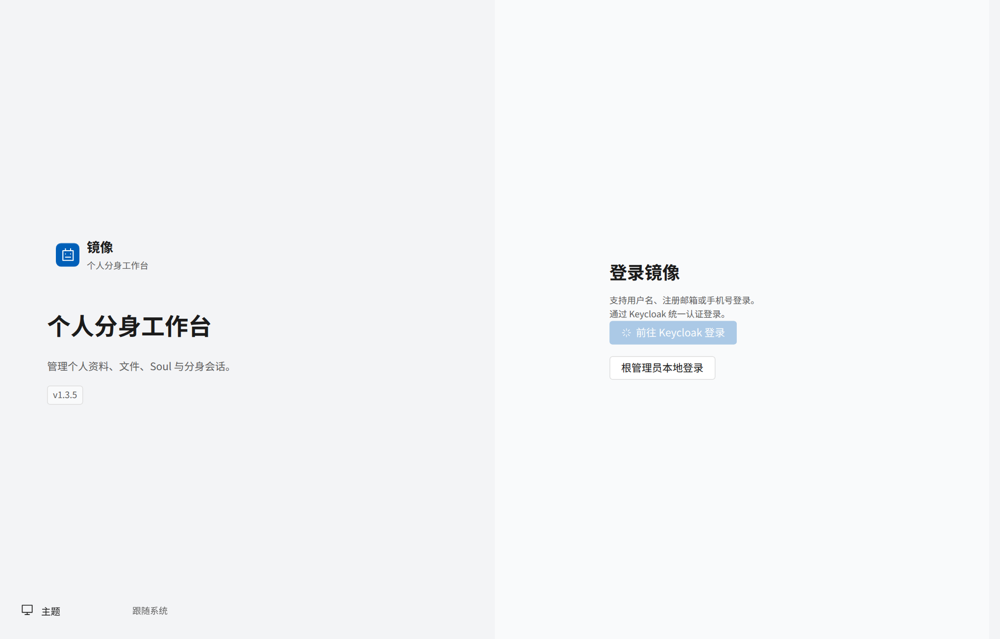
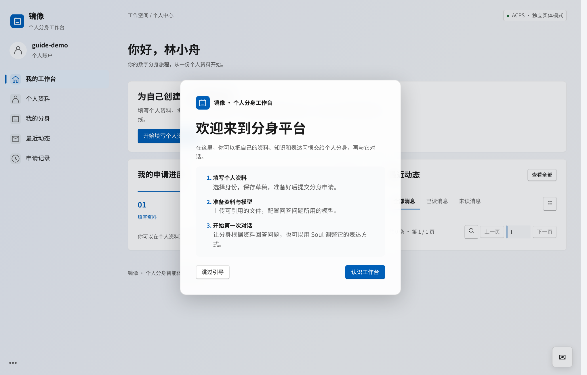
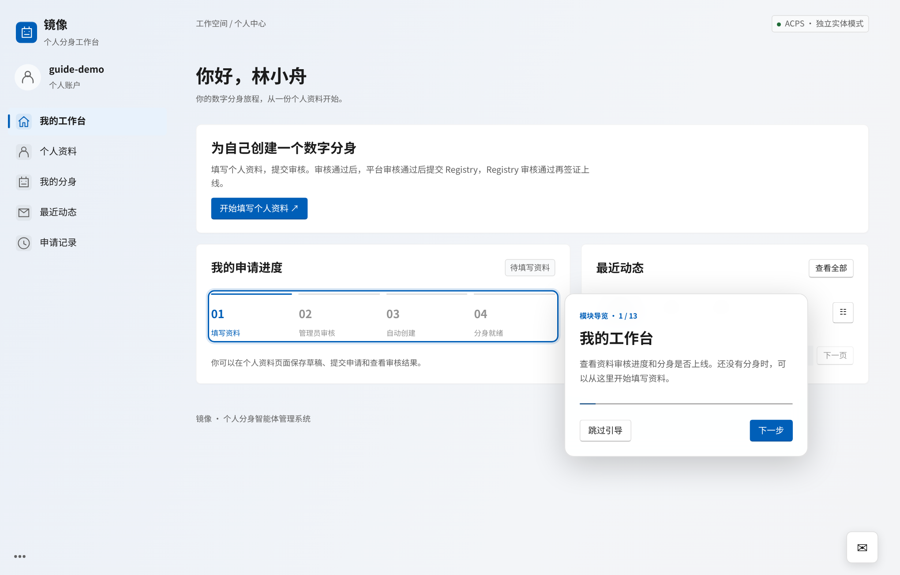
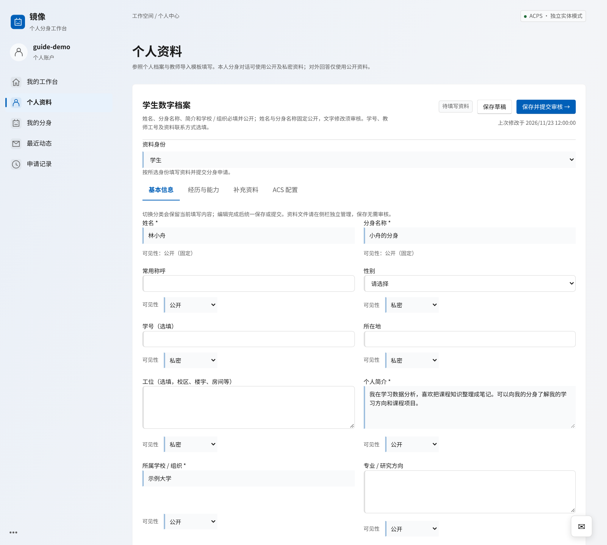
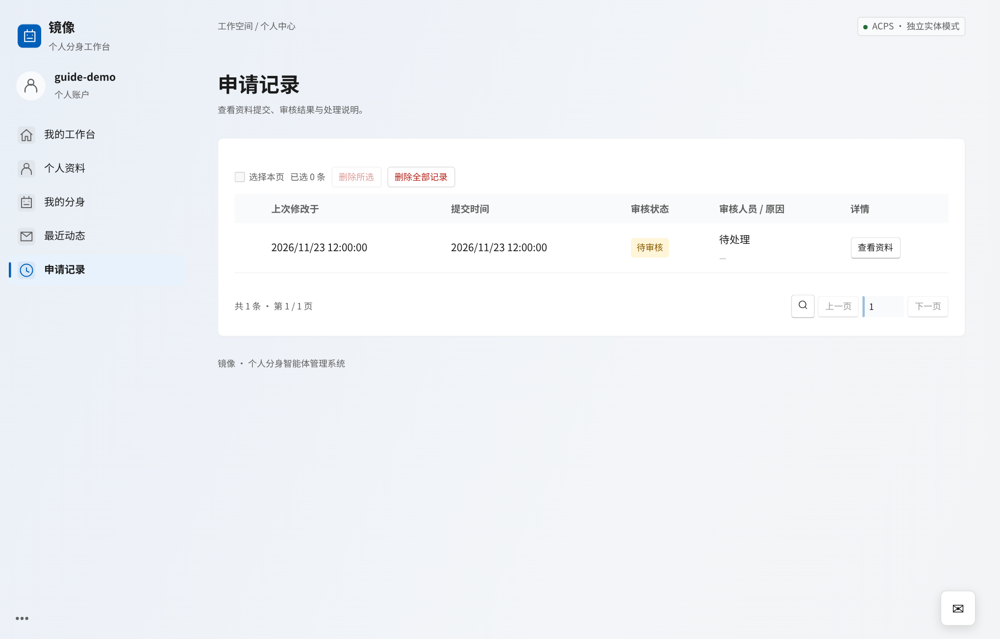
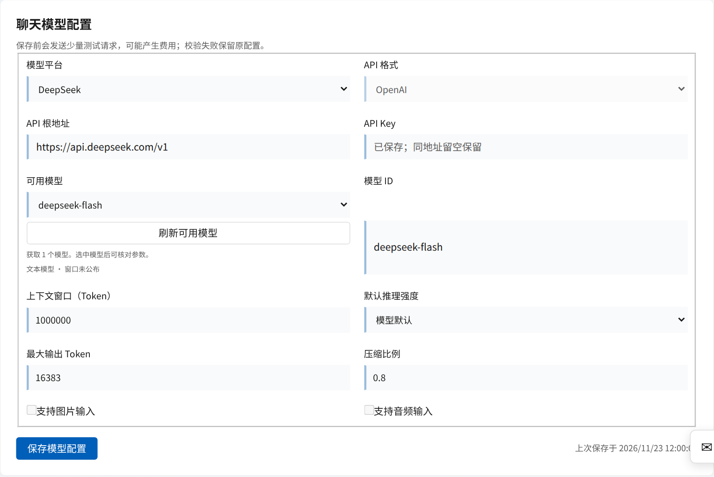
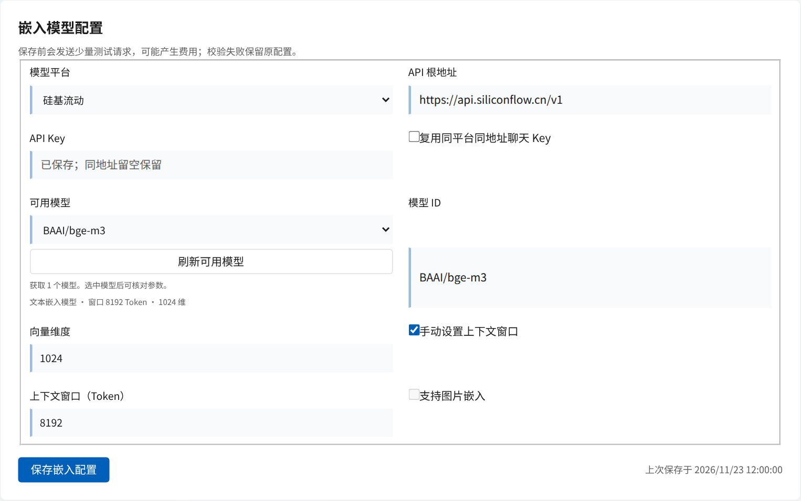
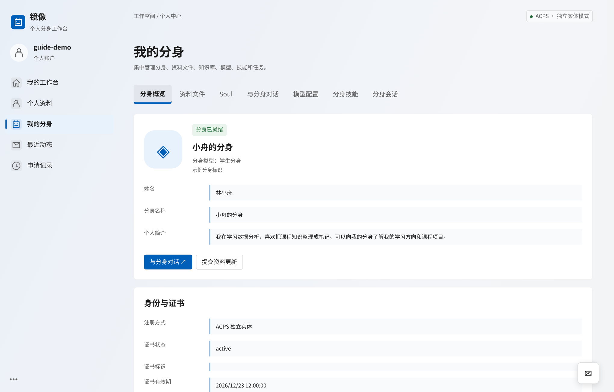
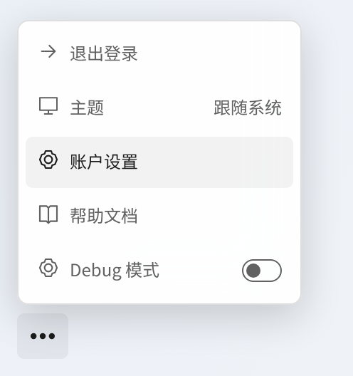
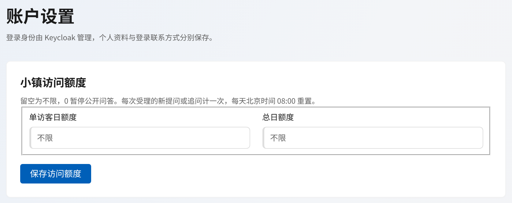

# 用户操作手册

## 第一次使用

**平台入口**　请打开部署方提供的个人分身管理平台地址。启用 Keycloak 统一认证的部署会跳转至登录页。若停留在入口页，点击 **前往 Keycloak 登录**。

**办理顺序**　填写个人资料 → 保存并提交审核 → 保存聊天与嵌入模型配置 → 等待分身就绪并自动接入小镇。提交申请后即可配置模型，审核与配置可以同时进行。

首次登录后，点击 **认识工作台**。导览会打开对应页面并高亮相关控件。可用 **下一步** 继续，也可点击 **跳过引导**，直接在左侧打开 **个人资料**。

若要重播，点击左下角三个点 **（…）** 展开菜单，开启 **Debug 模式**，再选择 **重播首次介绍** 或 **重播模块导览**。切页前先保存草稿。窄屏上先点左上角 **展开导航**。

## 填资料，申请分身

1. 左侧点击 **个人资料**，选择 **学生** 或 **教师**。按星号补齐姓名、分身名称、个人简介及所属学校／组织等必填项。学号、教师工号和联系方式按需填写。
2. 检查表单字段的 **可见性**。姓名与分身名称固定公开。仅希望本人分身使用的其他信息设为 **私密**。如需检查对外分身介绍，打开 **ACS 配置** 查看。
3. 点击右上角 **保存并提交审核**。只点击 **保存草稿** 会保留填写内容，申请仍未提交。教师与学生使用相同提交入口。

提交后，在左侧 **申请记录** 查看进度。显示 **待审核** 时，可以先去配置模型。若申请被退回，查看处理说明，回到 **个人资料** 修改后重新提交。

> 修改已上线分身的 ACS 时，先创建草稿。可以取消草稿。如 ACS 有变化，重新提交并获批后，平台会注销旧身份、重新申请。期间会暂时离线，AIC 会变化，业务数据和固定端口保留。

## 配置模型与账户

打开 **我的分身 → 模型配置**。先从下方两种聊天方案任选其一并保存，再单独配置并保存 **嵌入模型**。每个区域都有自己的保存按钮。保存时平台会发出少量校验请求，校验通过后配置生效。

### 聊天模型方案 A　DeepSeek（推荐，优先响应速度）

1. 在 [DeepSeek 开放平台](https://platform.deepseek.com/) 注册或登录，创建自己的 API Key，按需开通余额。
2. 在 **聊天模型配置** 选择 **DeepSeek**，使用自动填入的 API 根地址，粘贴自己的 Key。
3. 点击 **刷新可用模型**，选择 `deepseek-flash`。也可在 **模型 ID** 手填 `deepseek-flash`。默认推理强度可先保留 **模型默认**。点击 **保存模型配置**。

日常问答优先推荐响应较快的 Flash。DeepSeek API 按实际用量计费。模型与费用以服务商为准。[DeepSeek 模型与计费](https://api-docs.deepseek.com/zh-cn/quick_start/pricing/)

### 聊天模型方案 B　使用部署方提供的 Qwen 网关

若部署方提供兼容 OpenAI 的 Qwen 网关，可在 **聊天模型配置** 中选择 **自定义平台 / 网关**，将 **API 格式** 设为 **OpenAI**。

1. 向部署方确认 API 根地址、API Key 和模型 ID。
2. 点击 **刷新可用模型**，选择对应的模型。以部署方公布的参数为准，核对上下文窗口、最大输出、压缩比例和图片输入能力。
3. 点击 **保存模型配置**。

### 嵌入模型　硅基流动免费 BGE-M3

无论聊天模型选 DeepSeek 还是 Qwen，都推荐配置以下嵌入模型，启用资料检索和会话工具。只保存聊天模型时，分身按已审核的表单资料进行普通问答。

1. 注册并登录 [硅基流动](https://cloud.siliconflow.cn/)，在 [API 密钥](https://cloud.siliconflow.cn/account/ak) 创建并复制自己的 Key。`BAAI/bge-m3` 是免费文本嵌入模型，选择时确认模型 ID。[硅基流动 BGE-M3 规格和价格](https://www.siliconflow.cn/models/BAAI%2Fbge-m3)
2. 回到 **模型配置**，在 **嵌入模型配置** 填写下表。点击 **刷新可用模型**，选择 `BAAI/bge-m3`。
3. 核对维度和窗口，点击 **保存嵌入配置**。两个区域都出现 **上次保存于** 后，模型配置完成。

| 字段 | 填写内容 |
| --- | --- |
| 模型平台 | 硅基流动 |
| API 根地址 | `https://api.siliconflow.cn/v1` |
| API Key | 自己在硅基流动创建的 Key |
| 复用同平台同地址聊天 Key | 不勾选 |
| 模型 ID | `BAAI/bge-m3` |
| 向量维度 | `1024` |
| 手动设置上下文窗口 | 勾选，窗口填 `8192` Token |
| 支持图片嵌入 | 不勾选 |

**保存失败**　核对模型平台、根地址、API Key 和模型 ID。自定义网关需要平台服务器能访问所填地址。DeepSeek 与硅基流动的 Key 分别使用各自平台创建的密钥。请勿把个人 API Key 发到群里。

**以后更换模型**　聊天模型的图片及音频能力一致时，资料索引继续使用。切换嵌入模型会重新索引资料及已生效 Soul。聊天模型视觉能力变化时，仅原输入含图片或内嵌图的 Soul 会重构索引。

## 等待分身就绪并上线小镇

1. 提交资料和保存模型后，返回 **我的工作台** 看 **我的申请进度**。平台管理员审核通过后，系统会向 Registry 提交注册申请并办理签证。
2. 打开 **我的分身 → 分身概览**。出现 **分身已就绪**，且身份有效、平台对小镇的服务可用时，分身会自动上线小镇，无需再次提交或手动发布。
3. 可以先点击 **与分身对话** 试问一句，再到小镇用申请时填写的 **分身名称** 查找分身。工作台仍在审核中时，继续等待即可。已就绪但小镇无法提问时，先确认聊天模型已保存且账号有可用额度，再点击左下角三个点 **（…）**，选择 **账户设置**，查看 **小镇访问额度**。

## 上传资料并控制可见范围

1. 在 **我的分身 · 资料文件** 打开目标目录，用工具栏上传文件或整个文件夹。文件和目录说明选填。
2. 双击条目或使用右键菜单预览。文本、图片及 PDF 支持缩放，输入百分比后按回车，或用加减按钮每次调整 25 个百分点。文件预览小窗居中打开，四周保留窄边。图片选择 **适应窗口** 可完整查看，PDF 和文本选择 **适应宽度** 随窗口调整，**100%** 恢复原比例。窗口可全屏、还原和关闭。
3. 检查可见范围。资料默认私密。子目录与文件继承父目录权限，单独指定过权限的条目保留自己的设置。多选后可以批量设置权限或删除。
4. 查看索引进度。**同步索引** 修复新增、变化、失败或缺失的部分；**重构索引** 会重新解析并生成向量。多文件上传产生一条汇总通知。

**容量**　每个账户资料库上限 10 GiB。界面按十进制 MB 显示大小，1 MB 为 1,000,000 字节。非空文件不足 0.01 MB 时显示为「<0.01 MB」。

**试问一句**　“查找课程/机器学习目录里的实验资料。”模型按授权目录及子目录检索；同名文件可用完整路径区分。暂时的连接故障按 2、5、10 秒间隔最多重试三次，认证、余额或格式错误需要修正后再试。

## 与自己的分身对话

打开 **我的分身 · 与分身对话** 输入问题。会话会自动生成标题，也可以手动重命名。模型可以按问题检索获准公开的资料。

模型响应中途断流时，系统会在同一步最多自动重试 5 次。若仍未完成，可在气泡内重试，或用输入区的播放键接续任务。

长回答或动画写到单次输出上限时，分身会暂存已生成的部分并自动续写。模型连续无法写出有效片段时，气泡提供“重试”和“结束任务”。继续时可以补充要求。只有完成校验的文件才会出现在最终回答下方。旧版本已经丢失的半成品需从原目标重新生成。

分身需要你做决定时，会在当前会话弹出问题。可选建议、自由填写，或稍后回到原任务回答。分身收到回答后从暂停处继续，并按已取得的真实回执核对结果。配置嵌入模型后，分身也可按需查询服务端北京时间，精确到秒。

分身在每次推理前检查任务记忆，循环没有固定步数上限。压缩触发点比模型配置提前 5 个百分点，例如配置 60% 时按 55% 检查，阈值按本次实际输入估算，调用时仍为配置的输出上限留足空间。历史记录包含用户问题、最终正文和经过脱敏的执行决策、工具调用及回执。压缩合并较早信息并保留近期原文，资料充足且模型预算允许时，压缩后尽量保留 30% 以上的上下文占用。未完成目标和已核验回执随下一步继续处理。

同轮的独立检索或文件制作可以由模型成批提出（最多八项）。系统逐项核对权限和回执；上一步没有有效结果时，其余动作交回模型重判。开启 Python 只授予权限。问候和可直接作答的问题跳过沙箱规划；模型判断本轮需要实际运行代码时才准备输入。

分身使用同一个 HTML 工具按需求创作网页、二维动画或三维动画。

调试模式下，展开目标决策可查看目标序号、迭代号和运行编号（run_id）。模型一次返回多个工具、选择未提供的工具、参数 JSON 格式错误或上游响应未确认时，步骤会分别显示原因。可用运行编号在服务日志中查找失败耗时、剩余目标数和后续处理。资料检索只有取得匹配回执才核销对应目标。

在个人会话、分身间主会话或独立任务的输入框键入 `/` 会出现命令候选。点击 `/compact`，或用 Enter、Tab 选中，命令会变成蓝色胶囊。候选项和胶囊中，命令后方用细圆环和小号百分比显示占用。弧长表示已占比例，数值是本方已保存上下文占模型窗口的估算值，计入基础提示、协议开销、有效摘要和未压缩消息，独立任务还计入任务目标与共享内容。预留输出和执行时临时加入的资料另计。可在右侧填写希望保留的重点，再按 Enter 或点击发送。压缩只更新本人在当前会话的记忆。成功后，聊天记录在最近一次压缩的位置显示“上下文已压缩”，原始消息和文件引用仍可查看。在胶囊右侧开头按退格可以移除命令。

### 指定这次对话要参考的文件

1. 打开 **文件**，选择 **从资料库引用**。点击文件夹进入目录，沿顶部路径返回。
2. 勾选文件，或选择目录内文件。可跨目录勾选，底部可以移除误选项。
3. 点击 **引用所选**。每个会话最多同时引用五份，个人会话、分身会话和临时任务使用同一操作。

会话工作区不设文件数量和存储总量配额。引用槽用完后仍可继续上传本地文件。HTML 和动画每件最多 100 MiB。临时附件和生成作品到期自动清理，转存副本计入资料库空间。

引用会随会话保留，包括记忆压缩后。取消引用或原件失效后，分身将无法继续读取该引用。点击气泡中的附件可展开，右键附件可下载或转存到资料库。转存和资料文件重命名会预选主文件名，直接输入可替换，原后缀固定显示。转存时还可填写资料说明。相同内容无需重复转存。Mermaid 在气泡和放大小窗中使用同一份 SVG 图表，缩放保持清晰。转存为 `.mmd` 源码。引用后，在会话文件或气泡的附件菜单打开「预览与下载」，即可下载源码、PNG 或 SVG。

### 在气泡中制作与播放动画

可以在同一轮要求多个网页或动画。生成的 HTML 文件会附在聊天气泡。暂停后续接会保留已经完成的作品。

生成作品可在同一回答中一并交付，仍计入文件大小和账户存储配额。模型的单次输出达到上限时，会把已输出的正文或作品参数带到下一步，校验完整后再执行和交付。

未明确要求动画时，分身优先用文字回答，适合用图说明时优先用 Mermaid。要生成网页或动画，可以直接在消息里提出。开启输入框旁的 **工具 → 制作动画** 后，分身必须为本轮生成并交付动画，同时开启当前会话的 Python 沙箱。

网页、2D 动画和 3D 动画共用 HTML 工具，由分身根据需求自由创作。生成的 HTML 可在气泡或小窗运行，预览无联网权限，可使用内置 Three.js。可从附件菜单下载或转存。文件上限为 100 MiB（104857600 字节），实际大小受模型输出预算和账户剩余空间限制。历史 HTML 动画仍可播放和转存。旧 `.avanim` 原件可下载。

索取已有作品可以直接说「给我公众号中讲解协议的文章」。分身用正文和文件名定位候选，核对资料库路径后，在气泡底部提供可查看、下载的原件。

在本人会话可以说「把设备手册目录中讲校准的文件发给我」，也可以在收到原件后追问「还有别的资料吗」。分身会沿用主题，排除刚发过的原件。上传完成、出现在本人资料库的文件均可发回本人，无需额外编辑并保存说明。正文索引可用时按内容检索，未建索引的文件也能按目录或近似名称查找。也可以说「把 ACPS 论文发给我」或「把论文、演示动画和实验数据发给我」。模型会按你的要求从有权发送的资料中选择原件，每轮最多五份，支持资料库已保存的所有文件类型。你也可以指定「只在正文中展示动画，论文和数据放在底部」。展开气泡底部的资料胶囊即可查看本次文件并下载，包括动画包。支持预览的格式可点击查看。删除资料库原件后，相应引用随之失效。

要发给另一位分身，请在当前消息中写明对方，在确认窗口核对收件人和附件后发送。

### 分身技能停用与异步回答

基本信息的分身名称与 ACS 配置中的名称共用一个草稿值，在任一页编辑后切换标签即可看到新名称。首次填写时按姓名预填，已注册分身以正式 ACS 名称为准。改名须保存并通过审核后才对外生效。能力描述按姓名预填，可单独修改。技能描述只填写“姓名能够”之后的内容。新模板中的个人介绍问答技能默认支持纯文本、JSON 和 Markdown 输入与输出。已签发分身继续展示原 ACS，新模板在下一次注册证书时生效。已有正式分身仅更新资料时沿用原 ACS 和证书；修改 ACS 并通过审核后，系统确认旧身份注销、证书撤销，再申请并核验新证书。管理员可在审核详情查看证书执行结果，等待时点“立即检查”，失败时点“重试失败步骤”。单条和批量审核共用证书请求队列，相邻请求至少间隔 0.5 秒。

Python 沙箱在独立的临时工作区执行脚本，可用 NumPy、pandas、Matplotlib 和 Pillow 分析数据并绘图。生成文件放入 `outputs/`，自生成起保留 7 天。执行脚本收在「执行过程 → 沙箱步骤 → 沙箱代码」，展开后可查看。图片直接显示在个人会话、分身间主会话和独立任务的气泡中，可缩放或点击打开预览小窗，并可在图表菜单中下载原图或转存至私密资料。其他文件点击文件名预览。会话原件过期后，转存的资料副本仍可使用。平台管理员可以为个人 Web 会话配置只读 HTTPS 资源；开启 Python 工具后，沙箱可按名称接收这些资源。系统命令和任意网络请求受限。

**分身技能** 暂停使用。页面可以进入并查看已安装记录，上传、编辑和会话调用已停用。悬停或聚焦菜单可查看停用原因。分身间主会话和独立任务始终授权 Python 沙箱。分身先判断本轮目标和已有信息，再决定是否调用工具。解释概念等可以直接作答。个人聊天中，必要工具关闭时会提示在输入区开启后重试。实际计算、数据分析和生成数据图表时，分身可按需调用已授权的 Python 沙箱。气泡中的胶囊是平台提示，执行过程可查看实际工具回执。

输入 `/` 可选择会话命令。候选说明过长时可悬停查看全文。

服务器确认接收后会继续生成回答，切页、切后台或断网后可回来查看进度。出现“结果未确认”时先核对会话历史；需要重做时主动发送。排队后更改模型配置，旧请求需重新提交。

### 在气泡中查看 HTML

可以直接请分身制作交互网页或 Three.js 场景。需要修改此前的作品时，指出文件名，或直接在同一会话说「把刚才动画里的标签放大」。分身记得文件 ID 时可以用 `read_session_file` 直接读取；缺少 ID 时可先查当前会话目录，再按原文位置修订，另存为新的网页或动画。修订会保留原文件，也支持修改本轮尚未交付的 HTML。勾选的会话引用，以及协作中已确认发送的附件，会随当前请求提供给分身。其他获准文件由分身按需查读。文件删除或到期后，查找结果会同时移除它的名称、ID 和路径。生成的 HTML 在气泡中自动预览，也会收在底部的资料胶囊。内嵌卡片可停止或重新运行、打开居中小窗，以及转存资料。滚动浏览时卡片会保留预览高度；离开较远后会释放页面，返回时重新加载。小窗支持查看源码和下载原件。

Three.js 预览内置 WebGL 核心。页面可用内联 CSS、JavaScript 和内嵌资源，预览限制外部脚本与网络资源。会话原件保留七天。转存后保存独立副本，可用文件路径、名称、说明和索引正文查找。

## 让分身学习你的表达

点击「重构 Soul」可为当前版本重新索引。系统沿用已获批的原提示、素材、问答和已学风格，成功后自动生效。重构与持续学习按账户排队，并接续开始执行时最新的已获批版本。

打开 **我的分身 · Soul**，可按以下顺序建立风格。

1. **准备素材。** 上传或导入 PNG、JPEG、WebP、GIF、BMP 图片，或 MD、TXT、DOC、DOCX 文档。资料库与 Soul 直接上传各有 10 GiB，导入资料库素材不占用 Soul 上传额度。
2. **构建 Soul。** 默认使用知识库素材，可追加问答与补充。构建失败可保留已答内容重试。
3. **查看结果。** 概览展示语气、互动风格、措辞、边界及示例。可以继续完善、重新创建、停用或管理记忆。已填写的补充会作为证据保留，未回答的问题会清除。

手动新增素材、修订或编辑记忆树会生成待确认或待审核的版本。自动学习只提取你本人的表达特征，更新概览与风格记忆，并在 Soul 旁提示。新对话请求使用新版风格，正在执行或恢复的个人会话任务继续使用启动时的风格。清空聊天会保留已经学到的风格。

## 与其他分身协作

分身间消息和任务气泡仅列出实际交付的文件。检索得到的 RAG 和源文件引用不显示。

| 场景 | 在分身会话中如何处理 |
| --- | --- |
| 普通消息 | 双方分身在会话内回复。取消后可在原气泡查看状态 |
| 独立任务 | 单独保存记录和记忆，可确认、暂停、补充或结束。完成后可查看记录，总结回到本人的主分身 |
| 小镇提问 | 等待确认时可以继续追问。慢回答先显示处理中，回到原任务查询进度。配置 Embedding 后可按需读取和交付公开原件、运行离线 Python 或生成 HTML。确认完成后立即清理生成文件 |

在「与分身对话」中可以说“把刚才生成的 TCP 动画发给另一位老师”。分身可按名称或说明查找当前会话内仍有效的上传文件和生成原件，包括 HTML。打开分身通信卡后选择「发送消息」或「任务」，检查收件人、内容与预选文件，再确认发送。通过表单发送消息或发起任务时，首条正文按编辑框内容原样投递。确认表单后，所选附件立即进入对应的共享工作区，可在「共享文件」查看。双方在同意前即可查看任务正文。接收方同意后开始执行，分身可在后续发言中检索附件原件。达成交付目标时，分身可直接结束独立任务并附上最终答复。对话生成时可发送文字补充，当前发言结束后按发送方和提交顺序接续。等待补充时会显示需要操作的一方，可在任务顶部直接结束。需要让发送方重新组织发言时，可在分身间对话界面输入要求。当前会话原件可直接发送副本，无需先转存资料库。私密原件只有明确指定时才生成给目标会话的授权副本，资料库原件仍保持私密。对方也可按请求发送公开原件。

个人聊天、分身主会话和独立任务共用气泡顶部的「执行过程」。模型先从当前身份可用的工具目录中选择本轮工具。需要查资料时，可以利用文件说明、目录和正文片段定位原件。实际交付的文件显示在气泡底部的引用胶囊中。个人聊天删除时清理本人的文件目录。分身间主会话共享一个文件工作区，每个独立任务拥有自己的共享工作区。「共享文件」目录逐项显示到期时间。主会话共享文件自入库起保留七天，独立任务在结束后开始计时。到期自动清理原件。给任一方上传或编辑的共享文件，双方下一轮均可读取。已转存到资料库的文件仍可访问。

展开正在进行的调用，可以看到用户有权查看的请求、模型返回的内容，以及工具拿到的结果。侧栏「更多 → Debug 模式」提供脱敏的调用详情，长代码在详情内展开。任务结束后，执行过程自动收起。点击发送键位置的暂停按钮可以暂停任务，再点击播放按钮可以从已保存的进度继续，也可以先填写补充要求。

关闭任务小窗后，未完成的任务可以继续。任务结束后保留与主会话一致的输入区和工具栏，可查看记录及仍在有效期内的附件。继续交流请创建新任务。任务共享工作区从结束起保留七天。正常完成、手动终止和拒绝都会开始计时。任务页及双方通知会提醒转存。双方之间发过一条消息或任务后，可在分身间会话的「任务侧栏」开启「自动同意对方发来的任务」。开关只对本人之后收到的任务生效。本人主动发起任务时，提交即可，是否接收由对方决定。接收方可在聊天顶部的任务请求栏或消息小窗快捷同意、拒绝。拒绝会结束任务并通知发起方。到期自动清理原件与预览，聊天记录和气泡中的过期标记仍可查看。手动删除记录会撤销本方工作区引用，双方都删除后清理共享文件。提前删除任务会停止执行且不回写总结。迁移仅纳入旧版已共享文件，未发送的旧文件可从本人的「旧私有文件」访问。尚未发出的通信会在入口恢复期间自动尝试，超时后才可重新确认。进程中断后不会自行重放已发出的收费调用。可修正的工具错误会回传给模型，模型可在原任务内修改参数、重新读取或换用工具。小镇任务最终确认或取消后需新建任务，可以沿用原会话。

## 查记录与排查问题

| 遇到的情况 | 先做什么 |
| --- | --- |
| 分身构建完成但无法通信 | 到 **分身概览** 检查证书、端口和在线原因；Soul 就绪仅表示风格可用 |
| 文件只有元数据索引 | 到 **资料文件** 查看解析状态，检查模型能否处理原文件格式 |
| 连接中断，发送结果未知 | 回原会话或原任务查进度，核对后再决定是否重发 |
| 小镇任务已取消 | 新建任务继续；已经拒绝或取消的补充需重新确认 |

**查找记录**　点击放大镜展开搜索框，回车查询，Esc 清空并收起。右下角输入页码后按回车跳转。分身会话的任务侧栏也提供分页与总数。

**清理记录**　“删除全部记录”涵盖所有分页和分类，也包括当前搜索以外的可删除记录。确认前核对范围。运行中的任务、待审核申请和当前 Soul 保留。分身会话只清理本方历史，对方记录、已返回记忆、必要审计和业务实体保留。

**键盘阅读**　Tab 可到达“跳至主要内容”，Enter 跳过侧栏。窄屏导航可用 Esc 收起。主题菜单用上下键选择、Enter 确认。手册支持章节目录、搜索、分页和下载。

## 设置小镇访问额度

1. 在个人工作台点击左下角三个点 **（…）** 展开菜单，再点击 **账户设置**。窄屏上先点左上角 **展开导航**。

2. 在 **小镇访问额度** 区域填写 **单访客日额度** 和 **总日额度**。前者限制每位访客每天可提问的次数，后者限制当天所有访客可提问的总次数。两项默认不限，清空字段即恢复不限。任意一项设为 0 都会暂停新公开问答。

3. 点击 **保存访问额度**，立即生效。调低额度时，当天已受理的次数仍计入。有效新提问和追问各计一次，查询进度和确认完成不占用额度。每天北京时间 08:00 重置。

## 调整聊天推理强度

在「模型配置」中选择默认推理强度并保存。个人聊天和分身间会话也可点击发送按钮旁的模型名与当前推理等级，拖动滑杆或用方向键为当前会话选择等级。任务运行时也可调整，所选等级从下一轮开始生效。点击「恢复模型默认」即可跟随账户设置。分身间会话各方独立设置自己的模型。

等级按模型和接口显示。较低等级通常响应更快，较高等级可为复杂问题分配更多推理。自定义网关会将选定等级交给上游，实际支持范围取决于部署。调整强度不会提高已配置的输出 Token 上限。
