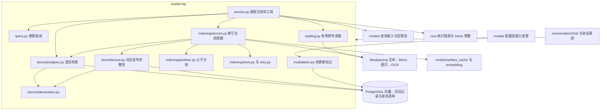
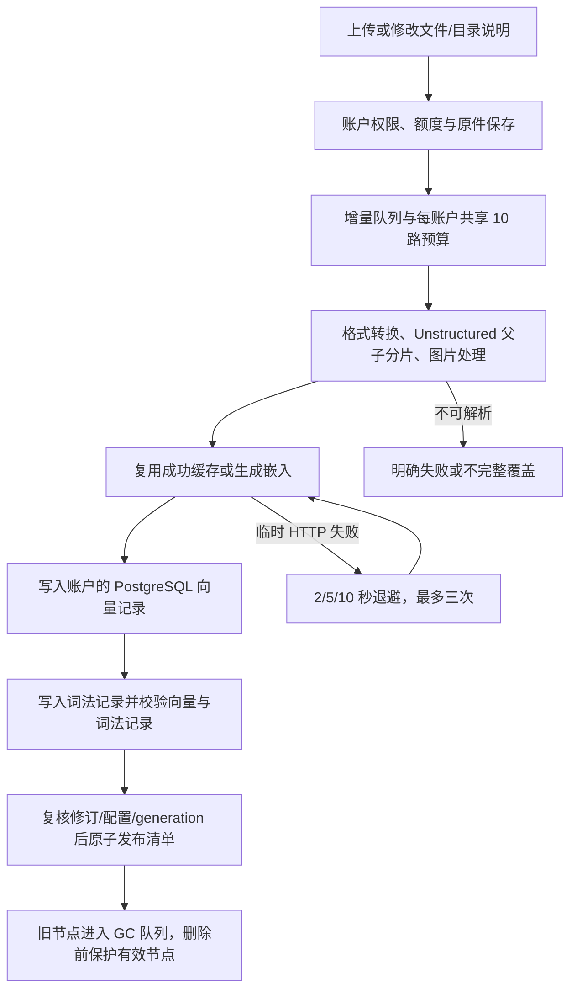
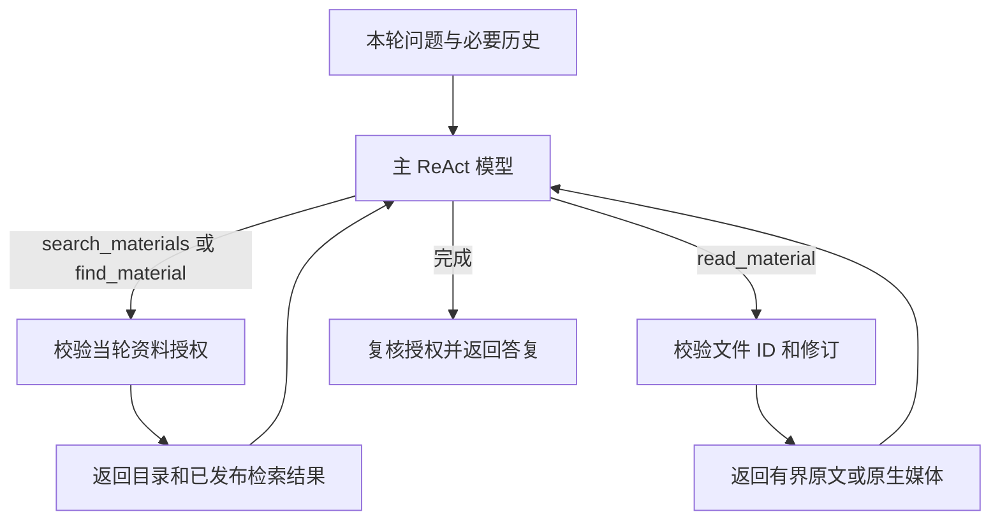

# 资料 RAG 与嵌入

当前策略按 2026-11-26 源码整理。资料事实检索与 Soul 风格记忆是两个边界；本文描述授权资料的索引、检索和原件读取。RAG 实现集中在 `avatar/rag`，原件存储和通用解析集中在 `avatar/files`；本次重构保留检索算法、索引签名和存储格式。

## 模型、额度与权限

每账户独立 LLM/Embedding 配置，Key 加密保存。能力优先来自服务端模型目录和已确认快照：已确认时锁定，未确认时允许用户纠正图片输入（聊天另可纠正音频输入），随配置保存；名称推测不算已确认能力。后续明确的元数据优先于手动声明。缺少嵌入时普通聊天继续，但跳过资料检索和 Soul 加载；配置后的真实错误不得静默当作成功。

网页保存配置前使用候选配置执行小规模实际 API 调用；失败不修改旧配置或触发索引失效。成功后核对并发修改再提交，才进入正常 RAG 更新。校验超时为 45 秒，目录发现仍是可选的后台能力识别，不代替可用性校验。

嵌入调用（索引、检索及 Soul）遇到可恢复连接、超时或限流错误时，最多额外重试 3 次，间隔 2、5、10 秒；耗尽后明确报错，索引外层不会再次重复这组重试。认证、维度、格式、配额及证书错误不重试。读超时后重试仍可能产生上游费用。

配置嵌入的会话由主 ReAct 模型决定是否检索资料或读取原件。已有文件 ID 时可直接读取，无需先命中向量索引。本人会话目录包含自己的公开及私密文件，其他调用按当前授权范围过滤。模型读取到的原件仅用于当前任务；后续按需再读取。图表只在模型实际收到对应画面后才能作为视觉依据。

沿同一文件追问详细信息或要求展开时，结合近期用户问题定位文件并重新进入原件读取；旧回答和 RAG 片段只能辅助定位，读取调度按需查找章节、图注及后续页，不将旧摘要扩写为新的文档事实。

本人索取多个主题的原件时，每项单独检索文件名、逻辑路径和已发布正文。分身可换词、限定目录或翻页，只能选取本轮展示的文件 ID。选择“最新”时优先比较相关候选中能核实的发布日期或路径日期。无日期依据时需要说明。部分命中会保留可交付原件，并指出缺少的项。收到澄清问题后，可以在同一会话继续补充资料主题。

资料问答的回答末尾显示本轮资料来源，格式为“文件名 · RAG”或“文件名 · 源文件”。由实际传入回答模型的证据及原件读取结果生成，按文件和类型去重；只列目录、未读取附件和读取失败项不算来源。来源随完整回答保存，流式回答结束后追加，小镇协议返回同样保留；历史旧回答不追溯生成来源。

Web 界面默认以叠放圆形文件图标和来源数量组成胶囊，点击在原位附近打开圆角来源弹层，按视口空间向上或向下展开，不撑高聊天气泡。弹层只保留滚轮滚动，不使用通用窗口的关闭、全屏、调整大小或帮助控件。支持再次点击、点击外部或 Esc 收起，不影响其他窗口；滚动聊天或调整窗口时收起。长文件名省略显示并保留完整悬停提示，已有保存的来源文本同样适用。

气泡底部的已发送附件与引用来源合并为一个“资料与来源”弹层，同名来源合并展示 RAG／源文件类型；附带实际会话副本的条目支持点击预览，附件只标注为会话文件，不冒充已读取的来源。普通分身消息沿配对会话继承仍启用且未过期的授权副本，独立任务只读取本任务授权文件。模型可看到可用原件目录，根据问题读取；未读取不能解释为未发送正文，也无需要求对方重发。

资料库总额度 10 GiB；聊天临时文件有独立限制。私密资料仅本人访问，公开资料按权限可检索；本人显式发送的私密原件只授权目标会话副本，不改变原文件权限。公开检索不会自动加入会话引用。明确引用记录独立于摘要，压缩不会丢失关联；每轮仍根据当前需求决定是否读取正文。

## 核心实现与分片策略

| 入口 | 核心职责 |
| --- | --- |
| `avatar/rag/service.py` | `MaterialRag` 统一授权目录、混合检索和来源复核 |
| `avatar/rag/query.py` | `FileQuery` 校验查询、逻辑目录和元数据条件 |
| `avatar/rag/indexing/service.py` | `FileRag`：增量队列、解析调度、向量缓存与原子发布 |
| `avatar/rag/indexing/partition.py` | Unstructured 标题父块、子块、邻接上下文 |
| `avatar/rag/indexing/work.py`、`retry.py` | 每账户及全局资源准入、临时故障退避 |
| `avatar/rag/stores/postgres.py` | 按账户和集合读取 PostgreSQL 向量，计算精确余弦排名，与 BM25Plus 经 RRF 融合并扩展父块 |
| `avatar/rag/stores/lexical.py`、`tokenization.py` | PostgreSQL 词法记录、全文检索与共用中英文分词 |
| `avatar/rag/reading.py` | `read_material` 按需返回原文页或原生音视频 |
| `avatar/rag/invalidation.py` | 模型配置变更时在调用方事务中将索引标记为待更新 |
| `avatar/files/parsing/reader.py`、`word.py`、`extract.py` | 原件按页/字符读取、Word 转换、通用正文解析 |
| `avatar/files/parsing/document_images.py`、`images.py` | 文档图片遍历、PDF 页渲染、有界图片编码 |

### 模块组成图

实线表示调用或数据流。文件解析器不导入 RAG；模型配置只调用轻量失效入口，不加载 `FileRag`。token 预算和生成授权上下文来自 `core`，RAG 无需导入会话实现。



`MaterialRag` 复用索引、权限与解析实现。原件工具返回受限文本或媒体，主模型决定是否补读。音视频使用 `knowledge/media.py` 的本地解析命令。

文本解析保留标题、章节、页码和邻接上下文。Unstructured 先按标题组织父块，再拆子块；长度按嵌入窗口约束，子块保留有限重叠和原元素信息，不再只按固定字符截断。Markdown 保留代码、表格及层级，文本编码统一受控解码。

分块参数以字符数约束结构切分：`width=max(128,min(1000,embedding_window-128))`，父块上限为 `max(width,min(6000,width*6))`；子块重叠为 `min(100,width//8)`，保留前后相邻子块及完整父块文本。不同 PDF 页不合并为跨页父块。进入嵌入前另按保守 token 估算检查窗口，必要时继续切分；全文件最多 2000 个分片，超限明确失败。

模型可以在同一步选择多条资料工具调用。文件 ID 和参数通过校验后才打开原件。失败回执返回主循环供模型调整，已取得的正文和检索片段分别标注来源。

Linux 上，RAG 首次索引和原文读取对不超过 4 KiB 的纯文本原件复用解析进程。更大原件沿用单次隔离解析，并继续读取父进程已经打开的同一份文件。支持 TXT、Markdown、MMD、CSV、TSV、JSON 和 LOG。父进程打开已授权的普通文件，通过私有 Unix 套接字传递只读文件描述符。每个服务进程最多启动两个解析进程，后台索引最多占用一个。每个解析进程在 64 个任务或 5 分钟后回收，正在执行的任务完成后退出。每个任务限制 30 秒 CPU 和 45 秒执行时间，每个进程最多使用 512 MiB 地址空间和 64 个文件描述符。

上传 DOC/DOCX 时，隔离的 LibreOffice 预先生成并保存私有 PDF 副本。预览、索引、模型读取和 Soul 共用该副本，按 PDF 处理正文和图片。副本随原件删除或过期清除，存储额度只计原件。索引与原文读取按转换后的页码定位，下载保留源格式。DOCX 仅含装饰横线时不调用视觉渲染。按[操作手册](操作手册.md#解析工具与模型)配置 LibreOffice 独立运行目录。优先按已确认能力直接嵌入图片，并可用视觉 LLM 提取实际可见内容。无法解析的图片明确标记不完整，不能声称全文/图片已读。解析受进程、时间、内存、解压和分片数量限制，不执行宏或访问外部网络。

音视频在资料库可以保存和预览，索引只含文件名与说明；分析音轨、画面通过授权原件读取工具按需执行。元数据索引成功不代表媒体内容已理解。Soul 上传音视频则须预先确认对应解析能力。

## 索引优化与增量发布

资料向量与正文存放在 PostgreSQL 的 `rag_vector_records`，按账户、集合、记录 ID 隔离。集合名包含嵌入目标、维度和缓存代摘要；记录 ID 覆盖内容、来源、结构元数据和向量。有效发布清单决定哪些记录可进入查询。旧 Chroma 目录随冻结快照离线导入，见[迁移说明](PostgreSQL运行.md)。

成功解析和向量缓存按账户、模型/配置、内容和注释隔离，复用未变化批次。同步索引只处理新增、变化、失败或物理索引缺失；健康且配置一致的索引保持原状态。资料文件改名仅编辑主文件名，保留原扩展名。改名成功后该文件自动进入索引队列，更新检索中的文件名。重构索引显式切换缓存代并从原件重新生成。资料文件页在后台索引期间显示已处理、正在处理和等待处理的文件数。已处理包括就绪、部分索引、失败和已阻塞，异常结果另列。模型图片嵌入能力变化会触发必要重构；权限变更在实时查询边界生效，不需要重新嵌入公开/私密内容。

旧分片立即退出当前检索，按现有 GC 窗口回收；原件删除同时撤销索引和访问。目录/说明变更按子树维护。文件索引和 Soul 素材工作合计每账户最多 10 路，共享重入槽；账户锁协调索引发布与垃圾回收。

发布顺序为：暂存待回收记录（1 小时保护窗）→ 写 PostgreSQL 向量记录 → 写同库词法记录 → 校验实际向量及词法条目 → 再核对文件修订、配置签名、队列 generation 与引用有效性 → 单个主库事务切换 `file_rag_nodes`、不可变 `rag_publications` 和 `active_publication` 指针。被替换的旧节点进入 7 天 GC 窗口；失败暂存节点标记为立即可回收。GC 删除前再次扣除当前有效节点，避免删除重用内容。

重建失败会保留旧发布指针；当前查询仍要求状态为 `ready`、修订和配置签名一致，因此保留旧指针不代表失败后会继续把旧证据用于回答。`legacy_backfill` 仅从已有向量回填词法记录，不重新解析原件或调用模型。

临时网络、超时、限流和可恢复服务端错误共享最多三次额外重试，间隔 2、5、10 秒，显示次数并保持处理中。认证、配额/余额、无效维度/格式和证书校验错误不重试；取消和进程重启不重放收费调用。模型端对读超时的请求仍可能计费。

## 查询构建与目录检索

主模型调用 `search_materials`，填写 `query`、最多两个 `alternatives`，以及所需的目录、文件 ID、文件名、类型、章节、来源和页码条件。`folder` 匹配完整逻辑路径及其子目录。授权由服务端判定，目录、路径和文件 ID 仅在当前授权文件中解析。

`search_materials` 返回授权目录、索引提示和已发布索引的证据。`find_material` 按页返回名称、路径和正文相关的候选文件。模型选定文件后，可调用 `read_material` 读原件，或在获准交付时调用 `send_material`。

### 实际检索顺序与阈值

1. 校验目标分身、公开性和当前调用授权。会话文件同时要求归属正确、已引用且未过期。执行授权快照作为额外的范围约束。
2. 按账户、集合分组，查询 `ready` 且内容修订和配置签名匹配的索引。未就绪的文件可按需读取原件，索引由后台独立执行。
3. 主查询与变体去重后最多执行 3 条。每条按 `max(64,embedding_window-128)` 字符拆段，嵌入后逐维取平均。嵌入遇到可恢复错误时可以使用已经发布的 BM25 候选。
4. 在授权记录内执行余弦和 BM25Plus 双路召回。两路对每条查询分别保留最多 36 个候选，按 RRF 融合并扩充邻接或父块。每集合和所有账户的最终合并均最多保留 12 条片段。
5. 检索回执最多为证据和目录分别分配约 4096 与 2048 个估算 token。来源只使用实际返回的证据片段。原件、授权或修订发生变化时拒绝继续使用旧证据。

`stores/lexical.py` 使用 PostgreSQL 的 `to_tsvector`、`to_tsquery` 和 `ts_rank_cd` 查询当前有效发布内的授权记录，并校验词法条目的完整性。在线 `PostgresFiles.search` 使用上述 BM25Plus 与精确余弦双路排名。 稳态并发、授权范围变化和排序一致性的实测结果见[资料 RAG 并发检索生产对照报告](资料RAG并发检索生产对照报告.md)。

## 原件读取与回答

主模型调用 `read_material(file_id, mode, start, end, offset, query)`。每次读取最多返回 12000 字符或 16 页，`next` 给出续读页码及偏移。`search` 定位正文短语，`full` 按相同预算分段。较长摘要由主循环基于实际读取范围生成。

PDF 和 Word 使用 PDF 页码。视觉模型每次可以接收起始页的画面，其他页可单独读取。图片原件返回首帧。音轨按 30 秒分片，视频返回同一分片内的中点画面。回执标明覆盖范围、采样和下一片位置。无对应能力时返回原因。

读取前后以及回答前复核归属、公开性、引用开关、有效期和内容修订。来源只来自实际取得的文本、图片或音频。用于后续续接的检查点保存结构化回执，不保存媒体的 Base64 内容。

分身发送公开原件是单独的授权工具，不等于 RAG 命中后自动发送文件。首次通信只附本次表单明确选择的文件；哈希去重保护重复引用和转存。

### 动画资料

动画以 HTML 保存。RAG 提取静态文字及资料说明，检索和原件交付沿用通用资料工具。

## 流程图





## 验证

```bash
.venv/bin/python scripts/run_tests.py --jobs 4 unit -q
```

测试使用模拟嵌入与 LLM，覆盖目录、公开性、私密副本、原件范围、同步/重构、重试和并发，不消耗实际模型额度。
