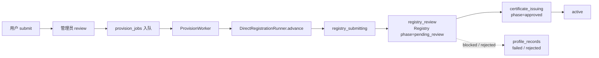

# 身份与协议

本文说明平台怎么给「人」和「分身」申请真实智能体身份、怎么把身份材料装进运行时、以及系统 AIP 与个人 AIP 的启动条件。
运维层面的证书与端口操作见 [操作手册](操作手册.md)，与小镇的对接约定见 [小镇接入交接](小镇接入交接.md)。

## 先把四个缩写分清

| 缩写 | 全称 | 在本项目里是什么 |
| --- | --- | --- |
| ACS | Agent Capability Specification | 能力说明书 JSON。`build_acs()`（`avatar/protocols/identity/acs.py:261`）生成，`protocolVersion` 为 `02.02`，安全方案声明 `securitySchemes = {'mtls': {'type': 'mutualTLS'}}`（`acs.py:282`）。`acs.json` 是每个身份唯一对外发布的文件。 |
| AIC | Agent Identifier Code | 智能体标识，落在 `avatar_records.aic`。demo 形态是 `DEMO-` + `uuid5(user_id)`（`avatar/protocols/registration/base.py`），正式形态由 Registry 签发。 |
| ATR | 注册 / 签证状态机 | wit 框架侧的注册流程与本地材料目录配置：`AtrConfig(registry_url, certificate_authority_url, registry_entity_mtls_url, acs_path, state_dir)`，读取入口 `read_atr_config()`（`avatar/protocols/identity/atr_config.py:10`）。 |
| AIP | Agent Interface Point | 对外 RPC 的**接口点**（端口 + 固定路径 `/aip/rpc`）。注意它是接口点，不是「应用间协议」的缩写。 |

## 身份材料放在哪里

```text
data/
├── system_identity/          系统（管理）身份：acs.json、证书及私钥
├── avatar_ontology/          个人分身能力本体（仅旧的 acps-entity 模式使用）
└── users/<user_id>/identity/ 每个分身自己的身份目录
```

每个目录里 `acs.json` 是对外材料，`state_dir/atr-state.json` 才是权威状态（`phase` / `aic` / `final_acs` / `fingerprint`）。

通信时的装载走 `LocalEntityDirectory`（`avatar/protocols/identity/document.py:85`）：**只读已提交的 active 材料**，日常通信不会去查 Registry 或 CA；加载时校验 phase、AIC、`final_acs` 一致性、候选指纹，以及 client 与 server 两张证书都已签发。

## 注册与签证流程



要点：

- 链路：`submit()`（`avatar/profiles/services.py:233`）→ 管理员 `review()`（`:267`）→ 写入 `provision_jobs`（`:288`）→ `ProvisionWorker.once()`（`avatar/runtime/worker.py:39`）→ `DirectRegistrationRunner.advance()`（`avatar/protocols/registration/direct.py:105`）。
- 阶段没走完时抛 `RegistrationPending(delay=settings.system_atr_poll_interval)`，worker 把任务置 `status='waiting'` 并写 `next_attempt_at`（`worker.py:95-98`）。
- `blocked` / `rejected` 转成 `RegistrationFailure(phase='registry_blocked' | 'registry_rejected')`，`profile_records` 落到 `failed` / `rejected`（`worker.py:101-108`）。
- 到达 `active` 后先原子写回 `acs.json`（权限 `0600`），再 `read_active_snapshot` 校验证书里的 AIC 与 ACS 一致，才 UPSERT `avatar_records` 并置 `identity_status='active'`（`worker.py:86`、`direct_registration.py:124-129`）。
- **平台不会替你去 Registry 点审批**：Registry 侧仍是人工审核，`pending_review` 只是提示状态（`avatar/runtime/system_registration.py`）。
- 前置硬条件：账户必须已绑定 Keycloak（`avatar/protocols/transport/endpoints.py:28`，缺失时报「个人分身需要先绑定 Keycloak 账户并登录同步用户名」）；并且 `name` / `avatar_name` / `bio` / `organization` 已填写且设为公开（`require_profile`，`direct_registration.py:38`）。

## provider 只有三个取值

`avatar/protocols/registration/base.py` 的适配器工厂只接受：

| provider | 含义 |
| --- | --- |
| `demo` | 本地演示身份，AIC 为 `DEMO-` 前缀，不申请正式证书 |
| `acps-direct` | 正式模式：每个分身作为独立实体注册（当前推荐） |
| `acps-entity` | 旧的「个人能力本体派生」模式，保留兼容 |

其它值直接抛错：`注册适配器只支持 demo、acps-direct 或兼容旧 acps-entity；正式模式需要完整 Settings`。
注意 `acps-direct` 下 `GET /api/avatar-ontology/acs` 返回 **410**（`avatar/api/system_routes.py:31`）——个人分身已改为独立实体注册，不再使用个人能力本体。

## 系统 AIP（管理端，端口 10000）

启动条件集中在 `avatar/runtime/system_aip.py` 的 `start()`：

1. `AVATAR_SYSTEM_AIP_ENABLED=1`；
2. 有正式 AIC（非空且不以 `DEMO-` 开头）；
3. `config.mode == 'integrated'`；
4. 候选身份的 `entityUserId == 'personal-avatar-manager-system'`；
5. 声明的端点必须在 ACS 的 `endPoints` 之内。

任何一条不满足都**只记录 `reason`，不会拖垮 Web 服务**；状态接口返回统一原因，不外泄凭据或文件内容。

- 端点由 `system_aip_endpoint()`（`avatar/protocols/identity/system.py:19`）解析，强制 `https` 且路径必须是 `/aip/rpc`；默认 `https://<服务器IP>:10000/aip/rpc`。
- 装配分支在 `avatar/api/app.py:63-66`：`system_atr_enabled=True` 时走 `SystemRegistrationRuntime`（每小时轮询，成功后 `activate` → `aip.start()`）；否则直接 `system_aip.start()`。
- 监听器参数：`PassiveTlsListener(max_connections=64, max_streams=1, request_timeout=15s, body 64KiB)`。
- RPC 任务通过 `SystemTaskStore` 持久化到 PostgreSQL 的 `system_management_tasks`。旧 `system_identity/aip-tasks.sqlite3` 需从冻结副本导入，保留命令 ID、任务、回执与截止时间。见[迁移说明](PostgreSQL运行.md)。

## 个人 AIP（分身端，端口 10001–15000）

- 总开关 `AVATAR_ENTITY_AIP_ENABLED=1`；`run()` 每 2 秒执行一次 `_sync()`（`avatar/runtime/personal_aip.py:129`）。
- 扫描条件：`aic NOT LIKE 'DEMO-%' AND identity_status='active' AND account_status='active'`（`:135`），再按 `(aic, 端口, 证书指纹)` 的拓扑做增量启停——配置没变就不会重启监听。
- **端口独占且永久保留**：`entity_endpoint()`（`avatar/protocols/transport/endpoints.py:66`）首次分配即写入 `avatar_entity_ports(user_id PK, port UNIQUE, CHECK 1024..65535)`（建表见 `avatar/core/migrations/entity_lifecycle.py:13`），之后改名、重签、换 AIC、重启都**不会重新分配**，也不回收。
- 端口段校验（`entity_ingress_config()`，`:41`）：监听 host 必须取自 `system_aip_public_url` 的 IP，且端口段内不得包含 `system_aip_port`（10000）与 Web 端口。
- 监听器参数：`PassiveTlsListener(bind 0.0.0.0, max_connections=128, max_streams=1, request_timeout=180s, body 64KiB)`。
- 对外状态：`disabled | online | waiting | offline`（`status()`，`:187`）。
- **mTLS 强校验**：`PersonalPartnerHandler._handle()`（`:44`）要求 TLS 对端的 AIC 等于 `command.senderId`，否则返回 `-32003 个人分身 RPC 必须通过真实 mTLS 连接`；本地证书无效或正在更新时同样是 `-32003`。
- 健康检查由管理员按需触发（`personal_aip.health`，`:212`）：用 `taskId='health-*'` 做只读探测，期望返回 `-32001`。部署记录里「已配置」不等于「已验证外网连通」。

### 分身协作命令的重试

同一协作任务按两个 AIC 的收发方向独立处理。每个参与方向先受理 `start`。收到 `awaiting-completion` 后可发送下一轮 `continue`。若该方向返回 `awaiting-input`，界面展示询问并等待用户选择。发言方补充信息后，平台按新修订号向同一方向发送 `continue`，恢复原任务。参与方选择结束时，平台核对暂停修订号并记录终态。同一命令 ID 携带原载荷重发时返回已记录结果，载荷变化返回 `-32602`。升级前的生成记录缺少载荷指纹，使用 `get` 查询原结果。查询尚未受理的方向返回 `-32001`。

完成或取消时，发送方只联系已参与的方向，核对每个回执的任务、会话和终态后结束投递。若确认丢失，队列用原命令 ID 重试。接收方持久保存首次控制回执，迟到的模型结果无法覆盖终态。进程重启时，仍在生成的命令记为 `failed`，付费调用须由用户核对后重新发起。

## 两套生命周期状态，别混用

| 维度 | 字段 | 取值 |
| --- | --- | --- |
| 账号审核进度 | `profile_records.status` | `draft` → `pending`（首次）/ `updating`（已有分身）→ `creating`（平台审核通过）→ `active`；分支 `rejected`、`failed` |
| 身份材料状态 | `avatar_records.identity_status` | `active`（默认）、`unregistering`、`retired`（acps-direct 注销后）、`unregistered`（派生模式注销） |

身份维护任务表 `avatar_identity_jobs` 的 `action` 为 `register | renew | unregister`；同一账户只允许存在一条未完成任务（唯一索引 `avatar_identity_job_busy`）。
入口：`POST /api/admin/agents/{user_id}/identity/{action}` → 202（`avatar/api/entity_routes.py:12`）。

## 账号、会话与登录

- 口令：PBKDF2-SHA256，**310000** 轮迭代，库里存「盐 + 摘要」，不存明文（`avatar/accounts/auth.py:18`）。
- 会话 Cookie 名 `avatar_session`，`HttpOnly` + `SameSite=Strict`；数据库只保存 token 的 SHA256。默认有效期 43200 秒（12 小时），平台临时入口 1800 秒且 `access_scope='profile'`（`issue_session()`，`auth.py:72`）。
- 写请求必须带 `x-csrf-token`，与签发会话时返回的 CSRF 值比对。
- OIDC 登录：授权码 + PKCE（要求发现文档声明支持 `S256`）+ `nonce` + RS256 验签 + `userinfo` 的 `sub` 比对；`issuer` 必须精确匹配、端点必须同源 HTTPS，避免被发现文档引导到别的域名；`state` 有效期 5 分钟、一次使用，并按 IP 限流（`avatar/accounts/oidc.py`）。
- **根管理员不参与 Keycloak 绑定**，只允许本地登录（`avatar/accounts/oidc.py:164`，否则 403「根管理员仅允许本地登录」）。

## 后台循环清单

`create_app()` 在 lifespan 里拉起这些常驻任务（`avatar/api/app.py:60-78`，任务名统一带 `avatar-` 前缀）：

其中除系统注册与本体注册外的循环只在应用自己承担后台工作时创建（`run_worker=True`）；作为 WitComponent 嵌入宿主时由宿主统一启动，避免重复消费队列。

| 循环 | 节奏 | 职责 |
| --- | --- | --- |
| provision-worker | 1s / 等待时 2s | 推进注册与签证队列 |
| system-registration | 3600s（可唤醒） | 系统身份注册与激活 |
| ontology-registration | 3600s | 个人分身能力本体注册（旧模式） |
| identity-maintenance | 1s / 2s，失败后 3600s | 分身身份维护队列（注册 / 续期 / 注销） |
| personal-aip | 2s | 同步每个分身的 AIP 监听 |
| chat-generations | 0.25s | 认领并执行聊天生成任务 |
| model-capabilities | 启动时刷新 | 探测模型能力 |
| soul-builds | 2s | Soul 构建流水线 |
| file-rag | 常驻 | 资料解析与索引工作槽 |
| dialogues | flush 1s / once 0.4s / cleanup 60s | 分身间协作消息投递与清理 |

## 容易踩的点

- **上线后 ACS 默认只读**：必须显式走 `acs_edit` 才能改（`avatar/profiles/services.py:219`）。
- **改 ACS 的发布方式**是「注销旧身份 + 撤销旧证书 + 同端口重新申请」，期间分身离线，而且 **AIC 会变**，对端需要重新认识它。
- **正式证书续期不走业务 API**：`provider.renew` 对非 demo 直接抛 409，要用 wit 工具处理（`avatar/protocols/registration/entity.py:277`）；管理员侧排队续期走 `/api/admin/agents/{user_id}/identity/renew`。
- **运行时不查远端最新吊销状态**：本地撤销 / 注销立即生效，但别的系统新撤销的证书不会即时同步过来。
- **单进程假设**：`ProvisionWorker` 每个应用进程只有一个（`avatar/runtime/worker.py:18-22`）。要开多 uvicorn worker，必须先给队列加租约或 outbox，否则会重复推进同一任务。

## 相关文档

- [系统架构](系统架构.md) — 模块划分与数据边界
- [数据模型](数据模型.md) — 身份相关表与状态字段
- [API 概览](API概览.md) — 管理端身份与注册接口
- [小镇接入交接](小镇接入交接.md) — ACPS TaskCommand 语义与 Token 校验
